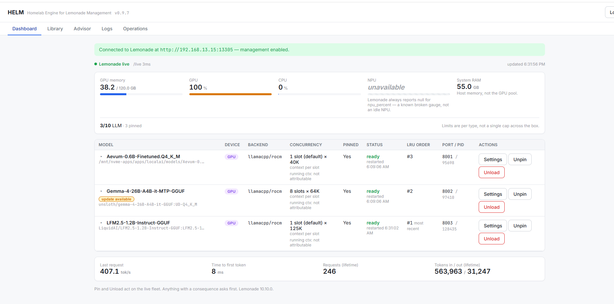
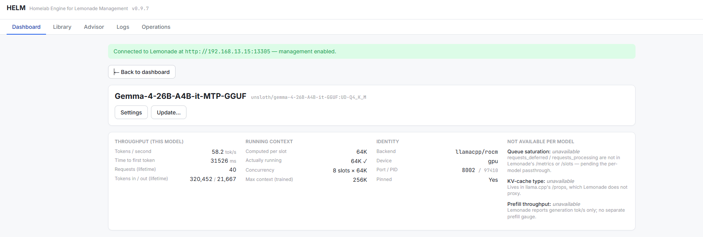
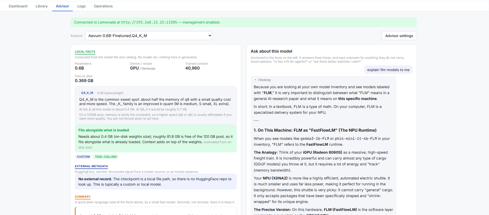
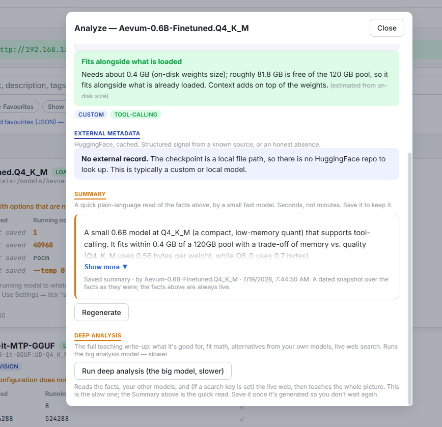
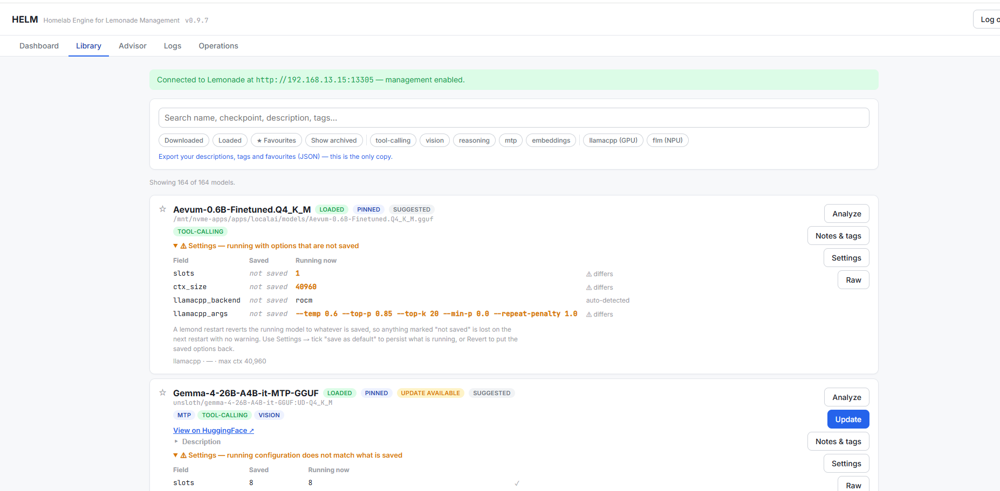
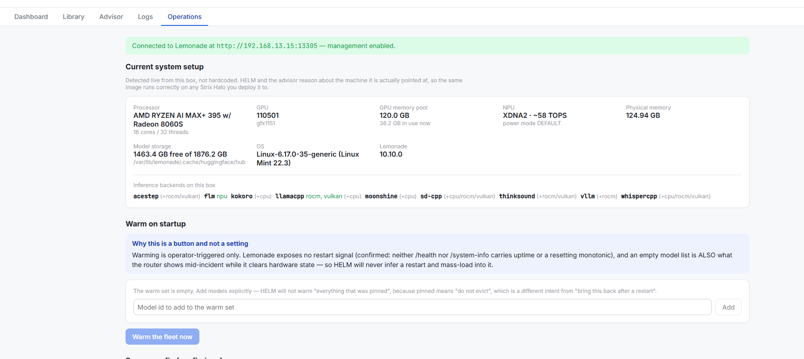

# HELM

> A read/write control plane for [Lemonade Server](https://github.com/lemonade-sdk/lemonade). See your local-LLM fleet honestly, manage it safely, and get grounded advice about your models — in one self-hosted web UI.

[](LICENSE)
[](https://hub.docker.com/u/brain40)
[](https://github.com/burrellka/HELM/releases)

> *Not [Helm the Kubernetes tool](https://helm.sh), and not the Stanford HELM benchmark — "HELM" here is a homelab control plane for Lemonade Server. The name's just a nautical nod: it's the **helm** for steering your local-LLM fleet.*

HELM sits in front of a Lemonade Server and gives you:

- **A dashboard** that tells the truth about what's loaded — real memory pool, derived per-slot context, throughput, crash detection — and renders "unknown" as *unknown*, never as a confident wrong number.
- **Safe controls** — load, unload, pin, and per-model settings — behind guardrails that refuse honestly (and can run fully read-only if you don't hand it an admin key).
- **A Model Advisor** that explains your models in plain language, *grounded in your actual hardware and inventory* — it teaches concepts freely but never invents a model-specific fact. A fast **Summary**, a deeper **Analyze**, and a streaming **chat** about any model.
- **Operations** — a live log tail, warm-on-startup, benchmarks, and a "current system setup" panel that reads your box live so HELM is portable to any machine by changing one URL.

It runs as a two-container Docker stack. Your models and your data never leave your hardware.

---

## What HELM does

Lemonade ships a genuinely fast local-LLM server — but a **minimal** UI: essentially a flat model list. The moment you run more than one model, tune context or sampling, or ask "why did throughput drop?", you're back to reading raw `/api/v1/health` JSON by hand. **HELM is the operator layer Lemonade doesn't include** — built on one rule: *show you what's true, or say it doesn't know — never a confident wrong number.*

### A dashboard that tells the truth

The real memory pool (not the phantom ceiling), **derived per-slot context** instead of the misleading raw `ctx_size`, live throughput, PID-based crash detection, and — right on each row — the context llama.cpp is **actually** serving vs what you configured (drift), plus an *update available* flag when a model's source has a newer build.



Expand any model, or open its dedicated page, for the full live detail — per-model throughput from Lemonade's `/metrics`, running context, and the fields Lemonade can't answer per-model shown as *unavailable* with the reason, never faked:



### A Model Advisor that's grounded, never guessing

The feature Lemonade has no equivalent of. It explains your models in plain language, **grounded in your real hardware and inventory** — teaching concepts freely, but never inventing a model-specific fact. Three ways in:

- **Quick Summary** — a fast, plain-language read of a model by a small model, in *seconds*, saved so it's instant next time.
- **Deep Analysis** — the full teaching write-up (fit math against your pool, alternatives from your *own* models, optional live web search) by the big analysis model. Also saveable.
- **Chat** — a streaming *"ask about this model"*, anchored to the facts on the left; it answers from those and says **"unknown"** for anything they don't carry, with its reasoning shown live.

Local facts (quant math, fit-against-your-pool), HuggingFace metadata (an honest *"no external record"* when there's no repo), and every generated sentence visibly labeled — no silent hallucinations.



The Analyze panel, with the fast Summary and the saveable Deep Analysis:



### A Library that actually manages models

Not just a list. Every model carries **capability badges** (tool-calling, vision, reasoning — with a tri-state that distinguishes "no tools" from "we couldn't tell"), your own **descriptions, tags, and favorites**, and unified search. Plus the things you'd otherwise do by hand:

- **Download** new models from the catalog, with a live progress indicator in the header.
- **Update** a model when its source has a newer build — one click, with the HuggingFace **model card shown before you pull**.
- **Per-model saved-vs-running drift** — see exactly where what's running diverges from what's saved, *before* a restart silently reverts it.



### Operations — your box, read live

A **"current system setup"** panel that reads the machine live — CPU, GPU, the real memory pool, NPU, inference backends, storage, OS, Lemonade version — so nothing about a specific box is hardcoded and the same image runs anywhere by changing one URL. Plus warm-on-startup, benchmarks, and a live log tail.



### Safe by construction

Load / unload / pin / config sit behind guardrails that **refuse honestly** (a clear local message, not a mysterious 401), pop a confirm before anything disruptive, and spell out exactly which models an action would evict. No admin key? HELM runs **fully read-only** — the whole dashboard and Advisor work, and the write controls are hidden with a note rather than shown failing.

---

## Why HELM exists

Lemonade Server is a fast, capable local-LLM runtime. But operating a fleet of models on it — which is loaded, whether the context you *think* you set is the context that's *actually* running, whether a model will fit, why throughput dropped — meant reading raw JSON or trusting a UI that quietly rounded the hard parts off.

The design principle HELM is built on came out of a real failure mode: **a control plane that displays a confidently wrong number is worse than no UI at all.** If HELM can't be sure of a value, it says so. If a model's slot count can't be parsed, the dashboard shows "unknown" — never a plausible-looking default that happens to be 8× off. Every generated sentence in the Advisor is visibly labeled as generated and traces back to a real, provided fact.

If you run one model and never touch its settings, you may not need HELM. If you run many, tune them, and want to *see what's true* before you act, that's what HELM is for.

---

## How HELM was built (and yes — it was vibe-coded)

HELM was **vibe-coded**: built conversationally, in natural language, by a person directing AI coding agents rather than typing the implementation by hand. It's not a toy that fell out of a single prompt, though — it's the product of a deliberate three-way collaboration, and it's worth being honest about how it came together, because the *method* shaped the result.

**The three of us:**

- **The operator** — owns the homelab, the Lemonade box, and every decision. Set the direction, tested each build against a real fleet, and kept the work honest ("show me it works, don't tell me it works").
- **The architect** ("H.A.L.O.") — owned the spec. Wrote the functional requirements, the correctness rules, and the review that caught the sharp edges *before* they shipped (the parser that could lie by a factor of 8, the memory pool that's easy to read wrong, the capability join that must distinguish "no tools" from "we don't know").
- **The developer** (an AI coding agent) — wrote and tested the code, ran it against the live box, and reported back with evidence.

**The approach that made it work:**

1. **Spec first, then build.** The architect's requirements and review findings (documented internally as F1–F11) became a checklist. Each was implemented *and tested against captured real payloads* before it was called done.
2. **Grounded, never recalled.** The guiding rule for the whole product, and especially the Advisor: state facts only from real, provided sources; teach concepts freely; and when something is unknown, *say unknown*. Small models fabricate under load, so the Advisor's default analyst is a capable model, and its instructions carry an un-editable safety floor.
3. **Verify before claiming.** Nothing was reported "done" on the strength of a green typecheck. Features were exercised end-to-end against the live Lemonade box — the load planner against real context math, the pin route reconstructed from a packet trace, the streaming chat timed for real first-token latency — and the evidence went into the notes.
4. **Fat genius over lean idiot.** When trimming, cut verbosity, never capability or grounding. A cheaper answer that hallucinates is worse than a slower one that's right.

The result is a codebase whose comments read like a lab notebook — they explain *why* a guard exists, often citing the incident that motivated it. That's deliberate. Vibe-coded doesn't have to mean unexamined.

---

## Quick start

You need a running **Lemonade Server** somewhere HELM can reach (same machine or elsewhere on your LAN).

> **New to Strix Halo / AMD Ryzen AI?** If you're still getting the box itself working — the memory pool, GPU/NPU, and Lemonade — my [Strix Halo setup guide](https://github.com/burrellka/MyStrixHaloSetup) walks through it from scratch for non-experts. HELM sits on top of that.

```bash
# 1. Get the compose file and the env template
curl -fsSL https://raw.githubusercontent.com/burrellka/HELM/main/infra/docker-compose.production.yml -o docker-compose.yml
curl -fsSL https://raw.githubusercontent.com/burrellka/HELM/main/.env.example -o .env

# 2. Edit .env — set HELM_LEMONADE_URL to your Lemonade server.
#    Leave HELM_LEMONADE_ADMIN_API_KEY blank to run read-only (safe first step).

# 3. Up
docker compose up -d
```

Open `http://<this-host>:5080`. The first visit lands on a setup screen — pick an operator password (≥12 chars, no recovery, store it in a password manager). HELM generates its own JWT signing secret on first boot; no key ceremony.

**Read-only first.** With no admin key, HELM shows the whole dashboard and the Advisor, and hides the write controls with a clear note. That's a fully supported mode — a great way to look before you touch. Add `HELM_LEMONADE_ADMIN_API_KEY` to `.env` and restart when you want load/unload/pin/config.

**Portable across machines.** Buying a second box? Deploy the same images there and change one line — `HELM_LEMONADE_URL`. HELM reads that machine's hardware live and describes it correctly; nothing about a specific box is baked into the code.

---

## Configuration

HELM is configured entirely through the **`.env` file sitting next to the compose file** — your container manager (Dockge, Portainer, plain `docker compose`) reads it automatically. Nothing is baked into the images, so the same images run on any box.

### The compose file, explained

This is a complete, minimal `docker-compose.yml`. It's the same as [`infra/docker-compose.production.yml`](infra/docker-compose.production.yml) (which carries extra inline notes); the version-pinned file is best for reproducible deploys, while `:latest` here keeps this example copy-paste-simple.

```yaml
services:
  helm-api:                              # the backend (FastAPI + SQLite)
    image: brain40/helm-api:latest       # or pin a version, e.g. :0.9.7
    container_name: helm-api
    user: "${PUID:-1000}:${PGID:-1000}"  # MUST own the ./helm-data dir below (see PUID/PGID)
    environment:
      HELM_LEMONADE_URL: ${HELM_LEMONADE_URL:-http://YOUR_LEMONADE_HOST:13305}
      HELM_LEMONADE_ADMIN_API_KEY: ${HELM_LEMONADE_ADMIN_API_KEY:-}
      HELM_LEMONADE_API_KEY: ${HELM_LEMONADE_API_KEY:-}
      HELM_JWT_SECRET: ${HELM_JWT_SECRET:-}
      HELM_WEB_SEARCH_KEY: ${HELM_WEB_SEARCH_KEY:-}
      HELM_DATA_DIR: /data
      TZ: ${TZ:-UTC}
    volumes:
      - ./helm-data:/data                # HELM's SQLite, JWT secret, operator hash — BACK THIS UP
    restart: unless-stopped

  helm-web:                              # the UI (nginx + the SPA; also proxies /api)
    image: brain40/helm-web:latest
    container_name: helm-web
    ports:
      - "5080:80"                        # open http://<this-host>:5080  (see Ports below)
    depends_on:
      - helm-api
    restart: unless-stopped
```

`helm-web` reaches `helm-api` by service name over Compose's default network — no extra network needed.

### Environment variables (all live in `.env`)

Copy [`.env.example`](.env.example) to `.env` and edit. Every variable and its expected values:

| Variable | Required? | Example / default | What it does |
|---|---|---|---|
| `HELM_LEMONADE_URL` | **Yes** | `http://192.168.1.50:13305` | Where your Lemonade Server listens. If Lemonade is a **host service** (not a container), use the host's **LAN IP**, not a container name. `http://localhost:13305` if it's on the same machine as HELM. |
| `HELM_LEMONADE_ADMIN_API_KEY` | No | *(empty)* | Gates the write routes (load / unload / pin / delete / config). **Leave empty to run read-only** — a fully supported mode; the dashboard + Advisor work and the write controls are hidden. Set it (from your Lemonade server's config) to enable management. |
| `HELM_LEMONADE_API_KEY` | No | *(empty)* | Only if you set a **global** `LEMONADE_API_KEY` on the server (it gates *all* routes, including reads, and disables Lemonade's own UI). Most people leave this blank. |
| `HELM_JWT_SECRET` | No | *(empty)* | **Leave empty.** HELM generates one at `/data/jwt_secret` on first boot and reuses it. Set only if you want to own rotation. |
| `HELM_WEB_SEARCH_KEY` | No | *(empty)* | A Google **Gemini** API key for the Advisor's grounded web lookups (separate from any model key; free tier is generous — [aistudio.google.com](https://aistudio.google.com)). Empty = the Advisor runs without live lookups and says so. |
| `PUID` / `PGID` | Recommended | `1000` / `1000` | The uid:gid that `helm-api` runs as. **Must match the owner of the host `./helm-data` directory**, or SQLite can't write and the container refuses to boot. Check with `id <your-user>`. Not the LinuxServer.io convention — this feeds Compose's `user:` directive directly. |
| `TZ` | No | `UTC` | Container **log** timestamps only. HELM stores UTC internally and the UI renders in the browser's timezone; this changes no stored data. |

### Ports, data, and backup

- **Port** — the UI is on `5080` (`"5080:80"`). Change the left number to move it. To bind localhost-only (e.g. behind a reverse proxy), use `"127.0.0.1:5080:80"`.
- **Data volume** — `./helm-data:/data` holds HELM's SQLite DB, the JWT secret, and the operator password hash. **It has no other source of truth — back it up.** The container side must stay `/data`.
- **First run** — open `http://<this-host>:5080`, set an operator password (≥12 chars, no recovery — store it in a password manager). No key ceremony; the JWT secret is generated for you.
- **Behind a reverse proxy / mTLS?** See [infra/npm-mtls-ingress.md](infra/npm-mtls-ingress.md) — including the streaming config that trips everyone up.

---

## Documentation

| Doc | What's in it |
|---|---|
| [docs/ARCHITECTURE.md](docs/ARCHITECTURE.md) | The technical design: containers, data flow, the shared arg parser, streaming, portability. |
| [docs/FUNCTIONAL-SPEC.md](docs/FUNCTIONAL-SPEC.md) | What each surface does and the correctness rules behind it. |
| [docs/CAPABILITY-GUIDE.md](docs/CAPABILITY-GUIDE.md) | A feature-by-feature walkthrough of the whole UI. |
| [docs/HELP.md](docs/HELP.md) | Task-oriented help — "how do I…" for common operations. |
| [infra/npm-mtls-ingress.md](infra/npm-mtls-ingress.md) | Optional: putting HELM behind Nginx Proxy Manager + Cloudflare mTLS, with the streaming config that trips everyone up. |

---

## The stack

- **Backend** — FastAPI (Python 3.12), `httpx` to Lemonade, SQLite for HELM's own state (operator metadata, settings, saved summaries). The container reports its own version, so "which image is running?" is always answerable.
- **Frontend** — React + Vite + TypeScript, dependency-light on purpose (its own compact, safe Markdown renderer rather than a heavyweight library). Served by nginx, which also proxies `/api`.
- **Two containers** — `helm-web` (nginx + SPA) and `helm-api` (uvicorn). One bind-mounted `/data` volume holds everything HELM can't rebuild by re-reading the box — so back it up.

Images are published to Docker Hub as `brain40/helm-api` and `brain40/helm-web`. Tags are immutable; `latest` always equals the newest version tag byte-for-byte.

---

## Security posture

- **Its own operator login.** Even behind a reverse proxy, HELM authenticates operators itself, because a control plane that can unload a model other services depend on — or delete gigabytes of weights — should never be one misconfigured proxy away from the open internet.
- **The admin key stays server-side.** It gates writes and is never sent to the browser. Read-only mode is a first-class supported state, not a degraded one.
- **No secrets in this repo.** Keys live in your `.env` (gitignored). The sample compose and env template ship with placeholders only.

---

## Status

HELM is actively developed against a live fleet. It has a read-only dashboard, full control surface, library management, operations tooling, and the Model Advisor with streaming chat. See the [release badge](https://github.com/burrellka/HELM/releases) for the current version.

---

## License

Apache License 2.0 — see [LICENSE](LICENSE). Use it, fork it, run it on your own hardware. No warranty; it manages a real inference server, so read what a control does before you click it.

---

*Built by a human operator, an AI architect, and an AI developer, against a real homelab. If you're one of the many people running local models and wishing you could just **see** what your server is doing — this was built for you too.*
