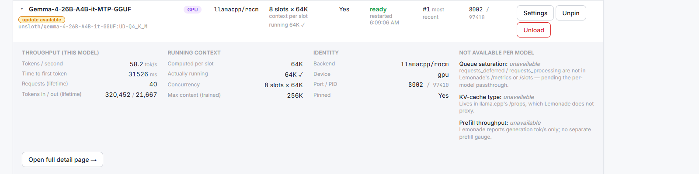

# HELM — Capability Guide & Walkthrough

HELM is a self-hosted web console for a **Lemonade Server** — the local runtime that
loads and serves language models on your own hardware. Lemonade does the inference;
HELM is the cockpit you drive it from: it shows you what is loaded, what it is doing,
what will fit, and (when you turn it on) lets you load, unload, tune, and benchmark
models without touching a terminal.

This guide is a tour of the UI, screen by screen. It assumes you are a capable homelab
user who has never seen HELM before. The one piece of philosophy worth knowing up
front, because it shows up everywhere: **HELM would rather say "unknown" than guess.**
When a number reads "unknown", "unavailable", or "no measurement", that is HELM being
honest about a gap in what the box reported — not a bug, and not a zero dressed up as a
fact.

A quick map of the tabs across the top:

| Tab | What it is for |
|-----|----------------|
| **Dashboard** | Live read of the running fleet: what's loaded, memory, throughput, crashes |
| **Library** | The full model catalog: browse, tag, download, configure, analyze |
| **Advisor** | Ask a model *about* a model — grounded analysis and chat |
| **Logs** | The live server log tail, with the important events highlighted |
| **Operations** | Detected hardware, warm-on-startup, benchmarks, global config |

---

## 1. Getting in

### First run — set the operator password

The very first time HELM comes up on a fresh install, it asks you to **create an
operator password**. This is the password that gates the whole console. A few things
the setup screen tells you, and means:

- **At least 12 characters.** HELM enforces the minimum.
- **There is no password recovery.** Store it in a password manager. If you lose it,
  the only reset is to delete HELM's `auth.json` from its data directory and restart —
  which starts you over at this same setup screen.
- If HELM notices the connection isn't HTTPS, it warns you that the session cookie
  won't be marked Secure. On `localhost` that's expected and harmless. On a real host
  it means your reverse proxy isn't forwarding the scheme header — worth fixing, but it
  won't stop you logging in.

After setup, every subsequent visit is a plain **Log in** with that one password.

### Read-only vs. management mode

Here is the distinction that trips people up, so learn it once:

- **The operator password lets you *in*.** By itself, it gives you a **read-only**
  console — you can see everything, change nothing on the fleet.
- **Management mode is separate.** It turns on only when a **Lemonade admin key** is
  configured for the HELM stack (the `HELM_LEMONADE_ADMIN_API_KEY` environment
  variable). That key is what Lemonade itself requires to accept load/unload/pin/delete
  commands.

When management is **off**, HELM does not show you greyed-out buttons that would fail.
The write controls are simply **absent** — no Load, no Unload, no Pin, no Settings-apply.
A banner at the top of every page says "Read-only" and names the env var to set. This
is deliberate: a button that 401s the moment you press it is worse than no button.

When management is **on**, the banner turns green ("management enabled") and the write
controls appear throughout.

**Opinion: start read-only.** Run HELM without the admin key for a while first. You get
the entire monitoring surface — dashboard, library, advisor, logs, benchmarks — with
zero risk of fat-fingering an unload on a model an agent is mid-request against. Add the
admin key when you actually want to manage the fleet from the browser.

---

## 2. Dashboard — reading the fleet

The Dashboard is a live read, polled a couple of times a minute (deliberately not
faster — the monitor must not become a load source on the box it is watching). Nothing
here is computed in your browser; every figure was derived and tested on the backend.

### The liveness strip

At the very top, a small dot and label: **"Lemonade live"** (green) or **"Lemonade not
responding"** (red), with the round-trip latency of the health ping and a timestamp. If
HELM's *own* API stops answering, the page keeps the last good read on screen and labels
it "last good read" rather than blanking — a stale-but-marked table beats an empty one.

### The resource header

A row of gauges:

- **GPU memory** — used vs. the total GPU memory pool, in GB. If the pool can't be read,
  it says "unknown pool" rather than drawing a bar.
- **GPU / CPU** — utilization percent, or "unavailable".
- **NPU** — this one **always reads "unavailable"**, on purpose. The underlying runtime
  reports null for NPU utilization on this hardware; rather than paint a confident "0%"
  (which would be a lie), HELM shows the honest gap and a footnote explaining it's a
  known-broken gauge, not an idle NPU.
- **System RAM** — host memory, explicitly *not* the GPU pool.

Below the gauges is a **capacity line** like `3/10 LLM · 1 pinned`. Read this carefully:
**the limits are per model type, not one cap across the whole box.** "3 of 10 LLMs" does
not mean "3 of 10 models total" — embeddings and other types have their own separate
ceilings.

### The pool warning

If the GPU memory pool has collapsed or can't be read, a prominent banner appears above
everything. The hard case ("the pool is collapsed — the GTT switch is off") is the
symptom of a specific misconfiguration that starves every model of memory; HELM surfaces
it in one glance rather than letting you discover it as mysterious slowness.

### The models table

One row per loaded model. Columns worth understanding:

- **Concurrency** — how many requests the model serves at once. For slotted (GPU/llama.cpp)
  models this shows the slot count and notes "context per slot"; for serial (NPU) models
  it shows that it's one-at-a-time. If it can't be determined, it reads "unknown" in a
  distinct muted style so you can't mistake it for a measured value.
- **Pinned** — "Yes" means the model is exempt from automatic eviction. Note the caveat
  in the tooltip: **pinned does *not* mean it reloads after a server restart.** Pinned is
  "don't evict me", not "bring me back".
- **Status** — "ready", "not ready", or **"DEAD"**. Extra flags appear here:
  - **⚠ restarted just now** / "restarted \<time\>" — HELM detected the backend process
    restarted (it watches the PID change, the reliable crash signal).
  - **watchdog fired** — the runtime's watchdog force-restarted this backend at some
    point.
- **LRU order** — a rank (#1 = most recently used), *not* a wall-clock "3 minutes ago".
  The underlying clock is a monotonic counter with no epoch, so HELM refuses to invent a
  time. What the column is actually *for* is eviction order: under memory pressure the
  least-recently-used **unpinned** model is dropped first, and the row that would go next
  is flagged "next evicted under pressure".
- **Port / PID** — the backend process behind the model.

An **empty table** carries its own note: no models loaded is also what the router shows
mid-incident while it clears hardware state after a backend failure, so an empty list by
itself does not prove the server restarted cleanly.

If management mode is on, each row gains an **Actions** column: **Settings** (jumps to
the model's configuration editor in the Library), **Pin/Unpin** (instant, no reload), and
**Unload** (disruptive — in-flight requests fail, reloading later costs ~10–20s). Anything
with a real consequence pops a **confirm dialog first**, and that dialog spells out
exactly which models an action would evict before you commit.

### The throughput strip

Lifetime and last-request stats: tokens/sec on the last request, time-to-first-token,
lifetime request count, and lifetime tokens in/out. One honesty note lives here: after a
one-token response the runtime can report a nonsensical rate (e.g. exactly 1,000,000
tok/s). HELM detects the implausible value and shows **"no measurement"** instead of
printing the lie.

### Running-context drift, and per-model live detail

Two things live on the model row itself. First, under the computed per-slot context, HELM
shows what llama.cpp is **actually** running (read live from `/slots`): a quiet `running 64K ✓`
when it matches, a loud warning when the running context has drifted below what you set
(a cap under memory pressure), and a quiet `running ctx: not attributable` when Lemonade's
model-blind `/slots` can't be pinned to this model — never a fabricated "no drift". Second,
a small **update available** pill appears on a loaded model when Lemonade reports a newer
build upstream; clicking it opens the Update flow in the Library.

Expand any row (the ▸ toggle) for the full per-model detail — fetched on demand, never on
the poll:

Per-model throughput comes from Lemonade's Prometheus `/metrics` (with the same
implausible-rate guard as the strip above). The **Not available per model** column is
deliberate: fields Lemonade can't answer per-model — queue saturation, KV-cache type,
prefill throughput — are listed **by name with the reason**, so you see the edge of what's
knowable rather than a blank that reads as zero. "Open full detail page →" gives the same
read its own page, with Settings and Update actions:

---

## 3. Library — the model catalog

The Library is your whole downloaded-and-available model collection. Search and filtering
all happen on the server; you send intent, not queries.

### Browsing, searching, tagging, favoriting

- A **search box** matches name, checkpoint, description, and tags.
- **Filter chips**: Downloaded, Loaded, ★ Favourites, Show archived; capability filters
  (tool-calling, vision, reasoning, mtp, embeddings); and recipe filters (**llamacpp
  (GPU)** vs **flm (NPU)**).
- **★ Favourite** any model with the star on its card.
- **Notes & tags** (per model) opens a dialog where you write a **description** and add
  your own **tags**. This metadata is *yours* — it lives in HELM's database keyed to the
  model id, survives restarts, and nothing upstream knows about it. That also makes it the
  one thing here that can't be rebuilt by re-reading the box, so **export it** (there's a
  JSON export link under the filters). Tagging, e.g., an uncensored build
  `do-not-deploy` is exactly what stops it being picked by accident out of a list of
  a hundred-plus models. You can also **Archive** a model to hide it from the default list
  without deleting the weights.

### Capability badges — and the state that matters

Each card shows capability badges (tool-calling, vision, etc.). Three states, kept
visually distinct on purpose because they mean very different things:

- **Badges shown** — capabilities as published for that model.
- **"no capability labels"** — HELM matched the model to the catalog and it genuinely
  advertises none.
- **"capabilities unknown"** — HELM *couldn't* match the model to the catalog. This is an
  absence of information, not information about an absence — treat any assumption about it
  as unverified. (Loaded models with no catalog row also get a warning banner at the top
  of the page.)

**The tool-calling badge is load-bearing, especially on the NPU.** On the NPU runtime,
tool-calling is compiled into the model kernel; a model that lacks it will have its tools
**silently stripped** — it never sees the tools and hallucinates an answer, with no error
anywhere. So any NPU model without the tool-calling label carries a hard red warning:
**"⚠ will silently strip tools."** If you're wiring a model to an agent, this badge is the
only reliable signal — not the name, not the size, not the family.

### Downloading, deleting

In management mode, an un-downloaded model shows a **Download** button; a downloaded,
unloaded model shows **Load** and a two-step **Delete** (which removes the weights from
disk — re-downloading may be many GB, so it makes you confirm).

### The saved-vs-running "drift" indicator

For a loaded model, the card carries a **Settings** panel showing **Saved** vs **Running
now**, side by side, field by field — always, even when they agree. This is the feature
nobody else gives you: it tells you when your 26B is *running* sampling settings that a
restart will silently discard.

- If everything matches, it reads "saved and running agree" and stays collapsed.
- If they differ, or the model is running with options that were never saved, it
  auto-expands with a ⚠ and highlights the offending fields.

The reason this matters: a server restart reverts every model to whatever was **saved**,
so anything marked "not saved" is lost on the next restart with no warning. The panel
gives you a **Revert to saved** button (reload using the persisted options, discard the
running ones), and the fix for the other direction — persisting what's running — is the
"save as default" tick in the Settings dialog below.

### The per-model Settings dialog

**Settings** (on a loaded model) opens the load/reconfigure editor. Because the runtime
has no "change options in place" call, **applying reloads the model** — it drops for
~10–20s and in-flight requests fail. The dialog says so plainly before you commit. Fields:

- **Slots (concurrent requests)** and **Context per slot** — you think in "8 slots of
  64K"; the runtime thinks in one big total `ctx_size`. HELM does the multiplication and
  shows the resulting total as a **read-only consequence**, so you never do that sum
  yourself. *Slot fields are hidden entirely for NPU (flm) models*, because the NPU is
  serial and a slot box would imply a setting that doesn't exist.
- **Backend** — auto, or an explicit choice (rocm / vulkan / cpu) for GPU models.
- **Sampling** — a row of structured fields: **Temperature, Top-k, Top-p, Min-p, Repeat
  penalty.** Leave a field blank to use the model's own default. (A blank means "don't
  set this" — which is genuinely different from setting it to zero.) HELM composes these
  into the runtime's argument string for you; don't also type them into the raw-args box
  below, because setting the same thing twice is rejected rather than allowed to silently
  disagree.
- **Extra arguments** — the escape hatch for raw llama.cpp flags. Context and device
  arguments are reserved (the runtime wires those itself) and HELM rejects them before
  sending.
- **Pinned** (exempt from eviction) and **Save as default** (persist these options so a
  restart keeps them). Without "save as default", the model runs with your options but
  persists nothing — it reverts on the next restart, and the drift panel will show it.

Every keystroke re-plans against the live fleet, so if a choice would force an eviction,
that warning appears **while you're still deciding**, not after you click.

### Raw config — the power-user hatch

Next to Settings, **Raw** opens a direct editor for the model's raw `recipe_options` JSON
— for keys the structured form doesn't surface. It is more powerful, not more correct, so
it runs the *same* guarded pipeline (covered in §6): read current first, validate on every
change, show the diff, back up before writing, confirm the reload, and keep a one-click
restore history.

---

## 4. Model Advisor — the big one

The Advisor is not a raw chat with a model. It is a conversation **about a model you
select**, pinned to that model's actual facts, so it teaches instead of hallucinating.
Pick a model from the **Analyze** dropdown at the top; the screen splits into two columns
— **grounded facts** on the left, **chat** on the right — plus an **Advisor settings**
panel you can toggle open.

### The left column: the Analyze panel

Four stacked sections, each with a colored provenance header so you can never mistake a
generated sentence for a measured fact:

1. **Local facts** (green — computed, no model ran). Parameters (with MoE total/active
   split when relevant), device & recipe, trained context window, size on disk, the
   **quantization** explained in plain language (with its size/quality trade-off), and a
   **fit verdict** — does it fit alongside what's already loaded, only if something is
   evicted, or not at all. Plus the capability badges again.
2. **External metadata** (blue — HuggingFace, cached). Repo, downloads, likes, license —
   or an honest **"No external record"** rather than a fabricated card.
3. **Summary** (the fast read). One button, **Summarize**. This runs a **small, fast
   model** (Aevum-0.6B by default) over just the facts card and gives you a plain-language
   "what is this, in a couple of sentences" in **seconds**. You can **Save** it (it then
   shows instantly next time, dated, as a snapshot) and **Regenerate** whenever you like.
4. **Deep analysis** (the slow, thorough read). A separate opt-in button. This runs the
   **big analysis model** over the facts *plus* your other owned models *plus* live web
   search (if a search key is configured), and teaches the whole picture — what it's good
   for, the fit math, better alternatives you already own. It's the slow one, generated on
   demand, not saved.

**Why two separate operations and not one button at two verbosities?** Because the deep
write-up is generation-bound and can take a couple of minutes on the big model. The fast
Summary uses a tiny model over a deliberately starved context to hit seconds. Use Summary
for a quick "remind me what this is"; use Deep analysis when you want to actually
understand a model's whole story.

### The right column: "Ask about this model"

A streaming chat anchored to the facts on the left. It answers from those facts and says
"unknown" for anything they don't carry. Good openers it suggests: *"is this a fit for
agents?"* or *"are there better matches I own?"* Two touches worth knowing:

- **The "Thinking" view.** The model reasons before it writes. That reasoning streams into
  a collapsible, clearly-labeled **Thinking** block that auto-expands while it's working
  and collapses once the answer arrives (your click sticks if you override it). It is the
  model thinking out loud — visibly *not* the answer.
- **The per-turn stats line.** Under each answer: prompt+completion tokens, any cached
  tokens (prefix cache hits), wall-clock seconds, and which model answered — so a slow
  turn is legible instead of a mystery.

### Advisor settings

Toggle **Advisor settings** to tune how all of the above behaves:

- **Analysis model** — the big model that writes the Deep analysis. Defaults to the
  resident 26B (no extra cost, already vetted as honest). Sub-2B models are kept in the
  list but flagged "not recommended, fabricates" — below 2B this judgment-heavy role
  invents specs.
- **Summary model** — *separate* picker for the quick Summary, defaulting to Aevum-0.6B.
  A small, fast, non-reasoning model is exactly right here, because Summary only restates
  the facts card in plain words. This is the one place a sub-2B is recommended. It has its
  **own instruction box** too, independent of the main advisor instructions.
- **Advisor instructions** — the editable persona/behavior for the deep analysis and
  chat: how it teaches, its sources of truth, when to search, how it recommends. Edit
  freely; it persists. A **locked safety floor** always holds underneath and can't be
  edited here — never state a model-specific fact from memory, never fake a citation.
- **Knowledge file** — the primer on how local models work (quantization, MoE, context,
  hardware fit). The advisor teaches *concepts* from **this document**, not its own recall.
  Paste, edit, or upload a new `.md`/`.txt` to update it. (Model-specific facts still come
  only from the computed facts, HuggingFace, and web search — never from this file.)
- **Web search** — grounded live lookup. Shows On/Off depending on whether a search key
  is set for the stack. You can pick the **provider** (Gemini grounding or Tavily) and the
  **search model**, and swap the model when a newer grounding model ships — it takes effect
  immediately, no redeploy, and the secret key stays in the stack's environment. A **Test
  search** button confirms it actually works and reports how many sources came back.

Every text field here has **Save** and, once you've customized it, **Restore architect
default** — so you can experiment freely and always get back to the shipped behavior.

---

## 5. Operations — hardware, warming, benchmarks

### Current system setup

A panel of the box's **detected** hardware — processor, GPU and its memory pool, NPU
(family and TOPS if present), physical memory, model-storage free space, OS, and runtime
version — plus the inference backends installed on this box.

**Everything here is read live, not hardcoded**, and that's the point: the same HELM image
deploys to any box, and both this panel and the Advisor reason about whatever machine the
instance is actually pointed at. Deploy it on a second machine and it reports that
machine's specs, and the Advisor's fit and speed advice follows automatically. That
portability is by design.

### Warm on startup

A model that is **pinned is still cold after a server restart** — pinned means "don't
evict", not "reload me". This panel fixes that gap, deliberately as **a button you press**
rather than an automatic setting. Why a button? Because there's no reliable "the server
restarted" signal in the API, and the only thing HELM *could* infer from (an empty model
list) is *also* what the router shows mid-incident. Automating a reload off that ambiguous
signal could pile load onto a box that's already in trouble. So:

- You maintain an explicit **warm set** — add model ids you want brought back. HELM will
  **not** auto-warm "everything that was pinned", because those are different intents.
- When you know the box is idle and want them loaded, press **Warm the fleet now**. If it
  needs confirmation (or would skip an NPU model), it tells you before doing anything.

### Server config (config.json)

The **global** Lemonade config — the memory-pool switch, ports, backends. High blast
radius. HELM lets you **View, edit, validate, and diff** it, and flags dangerous keys with
named warnings. But **Apply is intentionally not wired**: a global change is assumed to
need a full server restart that drops every model, and the write mechanism isn't confirmed
on this build. The UI says so and points you at the box's own `lemonade config set` for
now, rather than offering a button that might half-write a config and brick the server.
(Per-model config editing *is* fully wired — that's §6.)

### Benchmarks

Stored benchmark runs so model choices are evidence-based rather than folklore. Each row
records the **configuration it was measured under** — a tok/s figure without its slot
count and context isn't comparable to the next one. Runs are kicked off from a model's row
and execute **real inference on the shared box**, so they're never scheduled or automatic;
you run them when you mean to.

---

## Logs — the live tail

The **Logs** tab streams the live server log. Press **Start streaming** to begin; **Stop**
to end. It highlights the four events that explain almost everything else:

- **EVERYTHING EVICTED** (red) — a mass eviction, the kind that follows a backend failure.
- **watchdog** — the watchdog force-restarted a backend.
- **evict** — an ordinary single eviction.
- **slots / pool** — a load taking effect, and the memory-pool figure at startup.

Classification happens on the server (the rules are order-sensitive and easy to get
subtly wrong, so there's one tested implementation). Controls: a **Filter** box, an
**Events only** toggle, **Follow** (auto-scroll), and **Clear**. The pane is capped at 500
lines so a tail left open all day doesn't leak memory in your browser. If highlighting
ever fails, HELM still shows you the raw text — losing the color is annoying, losing the
log would be useless.

---

## 6. Config — editing a model's raw options safely

The **Raw** editor (reached from a model's card in the Library) is HELM's most powerful
control, and it's wrapped in the most guardrails. The full pipeline, every time:

1. **Read current first.** The editor never opens blank — it loads the model's actual
   running `recipe_options` so you're editing reality, not a guess.
2. **Validate on every change.** As you type, HELM re-validates and rejects reserved
   arguments (the context/device keys the runtime wires itself).
3. **Show the diff.** Before you apply, a **Changes** table lists exactly which keys are
   added, changed, or removed, old value → new value.
4. **Back up before writing.** The prior version is snapshotted automatically.
5. **Confirm the reload.** Applying reloads *this one model* (~10–20s down, in-flight
   requests fail) — that's the whole blast radius, and the confirm names it.
6. **Verify the read-back.** After applying, HELM re-reads to confirm the change took. If
   it can't confirm, it tells you so rather than claiming success.
7. **One-click restore.** A **Restore history** list lets you roll back to any earlier
   snapshot instantly. There's also **Reset to auto** — clear saved overrides and reload
   with the file's auto-detected defaults.

The same read → validate → diff → backup → apply → restore discipline backs the structured
Settings form too; Raw just exposes more keys. Nothing here can silently half-apply, and
nothing is unrecoverable.

---

## The one idea to take away

Wherever HELM shows you a number, it either measured it or it says it didn't. "Unknown",
"unavailable", "no measurement", "capabilities unknown", "not saved" — these aren't
failures of the UI, they're HELM declining to lie to you. Once you read the console that
way, everything on it is trustworthy: the honest gaps are marked, and everything else is a
real read of your box.
